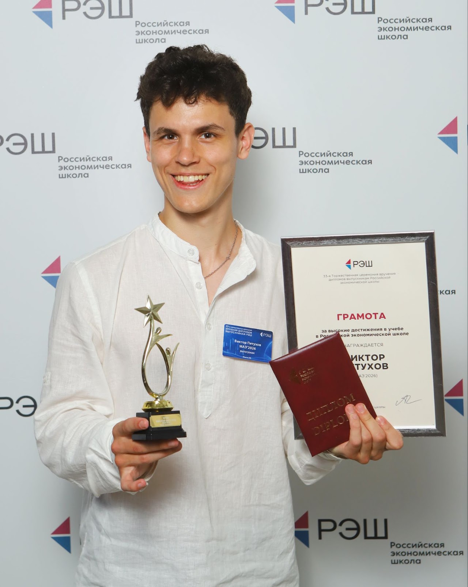

  

    <h1>Viktor Petukhov</h1>

    

      I am a recent graduate with honors from the Master of Arts
      in Economics program at the New Economic School in Moscow.
    

    

      I aspire to become an economist studying the microfoundations
      of and mechanisms behind autocracies and other nondemocratic
      regimes. My research interests lie in Development Economics
      and Political Economy.
    

    

      My projects combine theoretical insights and empirical
      analysis to understand political and economic phenomena.
    

    

      <a href="/assets/papers/cv.pdf">CV</a> |
      <a href="https://github.com/Vitolegg02">GitHub</a> |
      <a href="mailto:vpetukhov@nes.ru">Email</a>
    

  

  

## Research Interests

- Political Economy
- Development Economics
- Autocratic Institutions
- Conflict and Political Violence
- Natural Resources

## Current Research

I work on several projects studying political institutions,
economic incentives, and the behavior of political actors.

See my [Research page](/research/) for more information.

## Contact

Email: [vpetukhov@nes.ru](mailto:vpetukhov@nes.ru)
